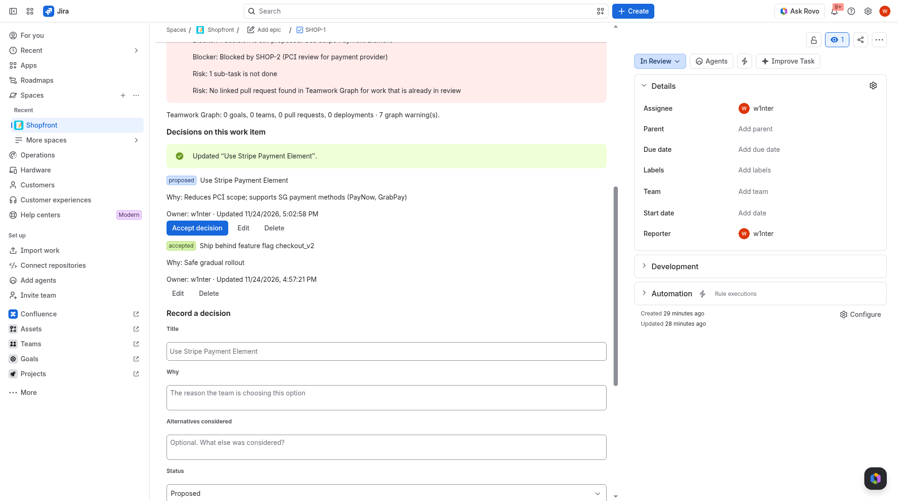
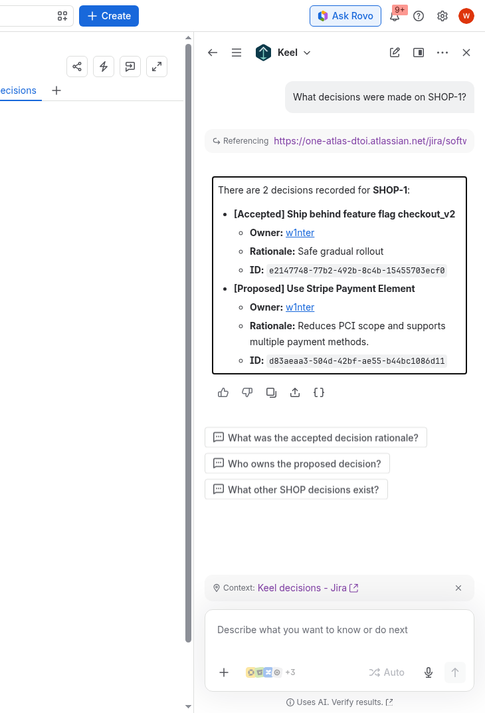
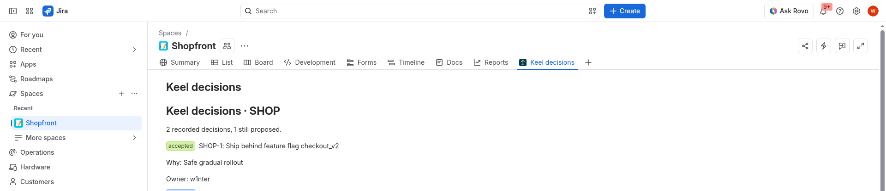

# Keel

**Record the why. Ship with confidence.**

Keel is an [Atlassian Forge](https://developer.atlassian.com/platform/forge/) app for software teams. It stores the *why* behind Jira work items and scores whether a change is actually ready to ship — not just whether the ticket is In Review.

Built by **Wynnter** for [Codegeist 2026](https://codegeist2026.devpost.com/): *Build with context. Ship with confidence.*

Track: **Apps for Software Teams**. Bonus categories: **Best Agents — Rovo / Assignable agents**, **Best app with Atlassian MCP**, **Best apps with Teamwork Graph integration**.

## The problem

Jira already shows status, assignees, and blockers. The decision that led to the work usually lives in a meeting, a Slack thread, or someone's head. An AI assistant can suggest a next step, but without that context it cannot tell you whether it is safe to ship.

## What Keel does

- **Issue panel** on a Jira work item: decision records (title, why, alternatives, status) and a ship-readiness score with blockers and risks. You can add, edit, accept, or delete a decision from the panel.
- **Project page** (`Keel decisions`): every recorded decision in the project, including ones still proposed.
- **Rovo agent (Keel)**: ask "Is this ready to ship?", "Why did we decide this?", or "Who should I ask?" The agent uses the same records and does not invent a yes.
- **Keel MCP**: the same tools for Rovo Studio and, when an admin enables external MCP, for coding agents such as Cursor.
- **Teamwork Graph**: people, teams, linked goals, pull requests, and deployments are folded into the readiness check. Missing graph data is treated as a gap, not a crash.



*The Keel issue panel on SHOP-1 (Checkout redesign). Stripe Payment Element is recorded with a clear why; PCI review on SHOP-2 still blocks the ship.*



*The Keel Rovo agent lists the decisions on SHOP-1, including status and rationale.*



*The Keel decisions project tab on Shopfront.*

## Architecture

The issue panel, project page, Rovo agent, and MCP tools all share one decision store in Forge KVS. There is no remote backend.

```
Jira issue panel  ─┐
Project page      ─┼─ UI Kit → resolver ─┐
Rovo agent (Keel) ─┤                     ├─ decisions (Forge KVS)
Keel MCP tools    ─┴─ actions ───────────┤─ Jira REST (route tagged templates)
                                         └─ Teamwork Graph (curated queries)
                                              ↓
                                       scoreReadiness()
```

`scoreReadiness` is a tested pure function:

| Signal | Source | Effect |
| --- | --- | --- |
| Proposed decisions | Keel store | Blocker → **Not ready** |
| Open "is blocked by" links | Jira REST | Blocker → **Not ready** |
| Open sub-tasks | Jira REST | Risk → **At risk** |
| Linked goal at risk, or in review with no linked PR | Teamwork Graph | Risk → **At risk** |

Headline status is `ready`, `at-risk`, or `not-ready`, with a 0–100 score. See [ARCHITECTURE.md](ARCHITECTURE.md) for scopes, Graph queries, and module details.

## Rovo agent, MCP, and Teamwork Graph

- The **Keel** agent is declared as `rovo:agent` with the prompt in `prompts/keel-agent.md` and conversation starters for ship-readiness, open decisions, and who to ask.
- Actions (also MCP tools via `rovo:mcp`): `list-decisions`, `record-decision`, `update-decision`, `delete-decision`, `get-ship-readiness`, `get-work-context`, `search-decisions`.
- An open skill file for third-party agents lives in [`mcp-skill/SKILL.md`](mcp-skill/SKILL.md).
- Graph access uses **curated Teamwork Graph queries only** (`jiraWorkItemGoals`, `jiraWorkItemComments`, `jiraWorkItemLinkedExternalPullRequests`, `jiraWorkItemLinkedExternalDeployments`, `atlassianUserInTeams`). New apps cannot issue raw `cypherQuery`.

## Install

You need Node.js 20+ (the app runtime is `nodejs24.x`), the [Forge CLI](https://developer.atlassian.com/platform/forge/getting-started/) 16+, and an Atlassian account.

```bash
git clone https://codeberg.org/wynnter/keel.git
cd keel
npm install
npm test
forge login
```

This repository already has an `app.id` in `manifest.yml` (`ari:cloud:ecosystem::app/6d480529-4bd1-412e-92c2-1bf5cd27b8b0`). If you are forking and want your own app, run `forge register` (it will write a new id). Then:

```bash
forge deploy
# optional: a free 90-day demo site with Jira, Confluence, and Rovo
forge site provision
forge install --demo-site
# or install on a site you administer:
# forge install --site your-site.atlassian.net --product Jira
```

`forge deploy` defaults to the development environment. For a shareable install link (needed for Codegeist judges), deploy and install production, then enable **Sharing** in the [developer console Distribution page](https://developer.atlassian.com/platform/forge/distribute-your-apps/#start-sharing-your-app). The Forge CLI cannot turn sharing on by itself.

```bash
forge deploy -e production
forge install -e production --site your-site.atlassian.net --product Jira
```

After install, open a Jira work item, choose **View app actions** (the Apps grid), and select **Keel**. Enable the Keel agent once in Rovo Chat → Browse Agents. Optional: in site admin, enable the Keel MCP connection and point a client at `https://mcp.atlassian.com/forge/<appId>` (see `mcp-skill/SKILL.md`).

Demo work items and the two example decisions are described in [`scripts/seed-demo.md`](scripts/seed-demo.md).

## Tests

```bash
npm test
```

Readiness scoring, decision patches, and a scan of product-fetch `route` usage run without Atlassian credentials.

## License

MIT. Copyright 2026 Wynnter. See [LICENSE](LICENSE).
